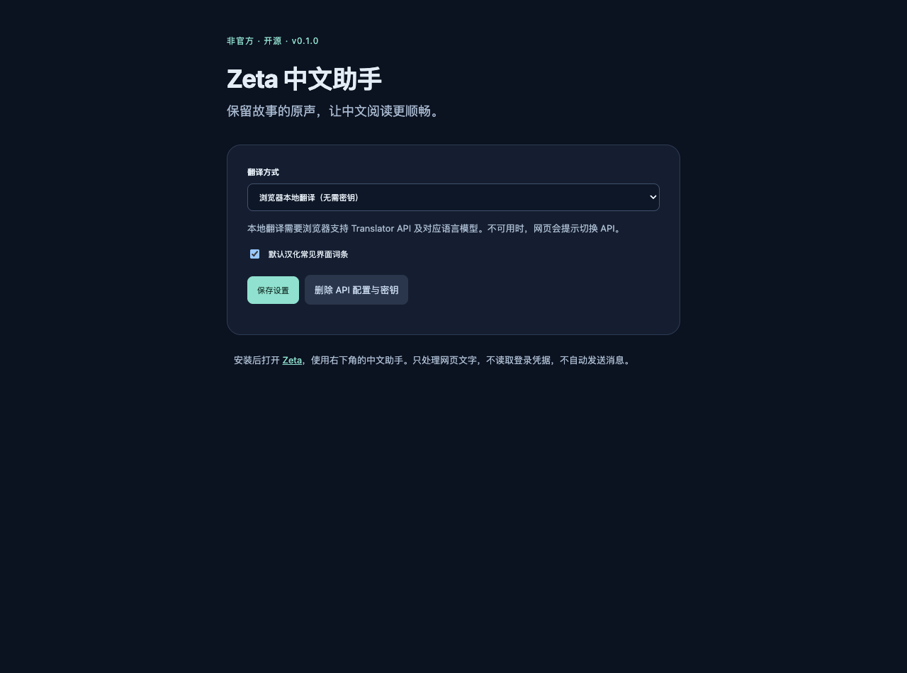

# Zeta 中文助手

为 [Zeta](https://zeta-ai.io/) 提供常见界面汉化和故事／聊天的中文双语阅读。**非官方 Chrome / Edge 扩展**，与 Scatter Lab 无关联。



## 能做什么

- 本地词典汉化常见菜单、按钮。支持英语、韩语、日语中的部分词条。
- **翻译选中文字**：适合单条聊天、人物介绍、剧情段落，中文显示在助手面板中。
- **翻译当前可见内容**：中文附在原文旁；每次最多 30 段、累计 12,000 字符。滚动后再次点击即可继续。
- 保留原文；可以清除译文、临时关闭界面汉化。
- 浏览器本地翻译，或自备兼容 Chat Completions 的 API。

不会自动翻译整个历史记录，不会替你发送聊天消息。当前版本不包含输入框中文转外语发送功能。新消息出现或滚动后，需要再次点击翻译。

## 安装

1. 下载本仓库 ZIP 并解压，或克隆仓库。
2. Chrome 打开 `chrome://extensions`，Edge 打开 `edge://extensions`。
3. 开启「开发者模式」，点击「加载已解压的扩展程序」，选择仓库内的 **`extension` 文件夹**。
4. 打开或刷新 [Zeta](https://zeta-ai.io/en)。右下角出现「Zeta 中文助手」。

如果下载的是 Release 中的 `zeta-zh-0.1.0.zip`，解压后直接加载包含 `manifest.json` 的文件夹。浏览器不能直接安装 ZIP；本项目尚未上架扩展商店。

## 翻译方式

### 浏览器本地翻译

默认选项，无需密钥。需要支持 [Translator API](https://developer.chrome.com/docs/ai/translator-api) 的桌面 Chrome、可用的语言对和模型；首次使用可能下载模型。扩展会检测可用性，不支持时给出提示。

在助手面板选择实际原文语言（英语／韩语／日语），再点击翻译。默认根据页面路径选择语言，混合语言内容应分段选择。**Edge 可加载扩展，但不保证其支持本地 Translator API；可用 API 模式。**

### 自备 API

点击浏览器工具栏里的扩展图标，打开设置：

1. 选择「自备兼容 Chat Completions 的 API」。
2. 填入**完整 POST 接口地址**、模型 ID 和 API 密钥。本项目不提供公共翻译服务或共享密钥。
3. 保存设置，并授权访问填写的服务域名。
4. 返回 Zeta，选择文字或点击翻译当前可见内容。

示例地址形式：`https://your-provider.example/v1/chat/completions`，需自行替换。接口接受 `model` 与 `messages`，返回 `choices[0].message.content`。支持 HTTPS，以及 `http://localhost` / `http://127.0.0.1` 本地服务。未调用需要付费的真实模型做验证。

## 隐私与权限

- 界面词典完全本地运行，无分析统计、无远程代码。
- 聊天翻译只在点击按钮后执行。本地模式将文本交给浏览器翻译 API；API 模式将选中文字或可见段落发给你配置的服务。
- API 密钥保存在 `chrome.storage.local`，不使用同步存储，并限制为扩展可信上下文读取。网页脚本无法直接访问该存储；本机用户可通过开发者工具查看，存储并非密码保险箱。
- 仅自动运行在 `zeta-ai.io` 和 `www.zeta-ai.io`。不读取 Cookie、登录 Token、网络聊天 API 或输入框中的草稿。
- `storage` 用于本机设置；可选主机权限用于用户配置的 API 地址，只在保存时申请该域名。更换服务、切回本地模式或删除 API 配置会撤销此前域名权限。
- 译文只保存在页面，刷新或清除后消失。没有翻译历史数据库或上传整段聊天历史的后台任务。

## 已知限制

这是 v0.1.0：常见词条汉化并非完整官方中文语言包，长文案、工具提示和未收录词条可能保留原文。可通过按需翻译阅读。

已验证公开首页、公开故事简介和开场白的 DOM；登录后的真实会话尚未实测。聊天支持通过通用文字选择／可见段落机制实现，不依赖私人接口。流式生成时请等文字稳定后再翻译；原文在翻译过程中改变时会跳过旧结果。Zeta 改版、虚拟滚动和复杂布局可能影响就地译文，选择文字翻译可作为备用。

译文内容由浏览器或所选服务生成，不能保证人名、剧情细节或语气完全准确。未验证真实付费 API 和本地模型的端到端翻译质量。

## 开发和验证

扩展没有构建步骤，也没有运行时第三方依赖。

```sh
npm test
npm run package
```

浏览器回归需要本机安装 Playwright 及 Chromium：

```sh
npm install --no-save --package-lock=false playwright
npx playwright install chromium
npm run test:browser
npm run test:extension
```

也可以设置 `PLAYWRIGHT_MODULE` 指向现有 Playwright 模块路径。测试使用本地模拟页面和模拟译文，不发送真实聊天、不消耗模型额度。覆盖动态汉化、聊天原文／编辑区隔离、选中／可见内容翻译、译文 XSS 防护、重复翻译跳过、恢复和页面切换清理。

`test:extension` 会在临时配置中真实加载扩展，验证设置页、后台与本机模拟 API 的完整链路。为适应无头浏览器，**仅临时测试副本**预授予本机接口权限；发布版保留按需申请权限。原生授权弹窗与真实服务的行为仍需人工验收。

打包产物位于 `dist/`，只包含 `extension/` 中的文件，不包含用户密钥、调研抓取或测试截图。

产品调研和适配依据见 [docs/research.md](docs/research.md)。词条维护在 [extension/dictionary.js](extension/dictionary.js)。欢迎用 Issue 提供页面路径、问题描述与脱敏截图，**不要提交聊天隐私、登录凭据或 API 密钥**。

## License

[MIT](LICENSE)。Zeta 名称、商标、站点代码和用户创作内容归各自权利人所有；本仓库不分发抓取的站点代码、角色图片或用户故事。
